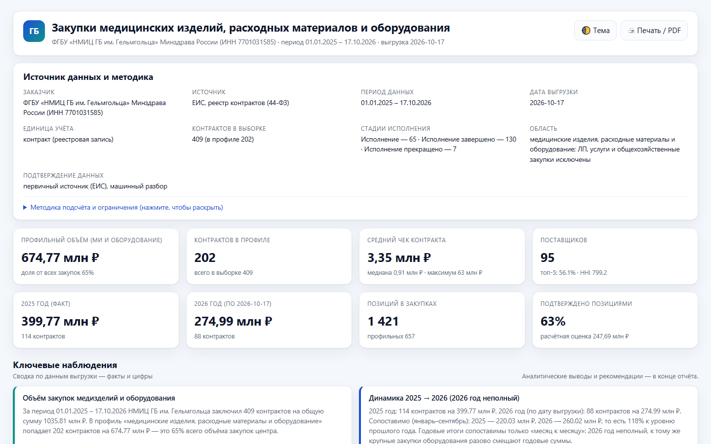

> [← Портфолио Марины Петрушиной](https://mary-rnd.github.io/portfolio/) — сайты, ИИ-боты, трекеры и автоматизация для малого бизнеса и MedTech.

# Демо-дашборд: закупки медицинских изделий и оборудования

Статический аналитический дашборд по одному ЛПУ — демонстрационный образец методики.

**▶ Живое демо:** https://mary-rnd.github.io/procurement-demo/

**Что внутри:** контракты за 2025 год (полностью) и 2026 год (на дату выгрузки), профиль —
медицинские изделия, расходные материалы и оборудование. Лекарственные препараты, услуги и
общехозяйственные закупки исключены.

**Источник данных:** ЕИС в сфере закупок (zakupki.gov.ru), реестр контрактов, 44-ФЗ. Открытые данные.

## Как смотреть

Откройте `index.html` в браузере — интерактивная версия:

- 8 ключевых показателей и 9 наблюдений;
- 7 интерактивных графиков: динамика по месяцам, структура по видам, категории, концентрация
  поставщиков, способы закупок, страны происхождения, топ номенклатуры;
- реестр контрактов с фильтрами (год, стадия исполнения, только профильные, поиск) и ссылками
  в карточки контрактов на zakupki.gov.ru;
- реестр позиций с поиском по КТРУ, ОКПД2 и поставщику;
- раздел «Аналитические выводы и рекомендации» — в конце отчёта;
- переключение светлой и тёмной темы;
- печать в PDF: кнопка «Печать», вёрстка рассчитана на A4.

## Данные таблицами

`gelmgoltsa.xlsx` — те же данные в 10 листах: сводка, контракты, позиции, поставщики, категории,
способы закупки, статусы, страны, динамика по месяцам, ценовые бенчмарки.

## Ограничения

- Учитываются контракты, а не извещения; выборка охватывает все стадии исполнения.
- Суммы, подтверждённые позициями, помечены как точные; распределённые расчётно — как оценка.
- 2026 год неполный: сравнение годов приводится только в формате «месяц к месяцу».
